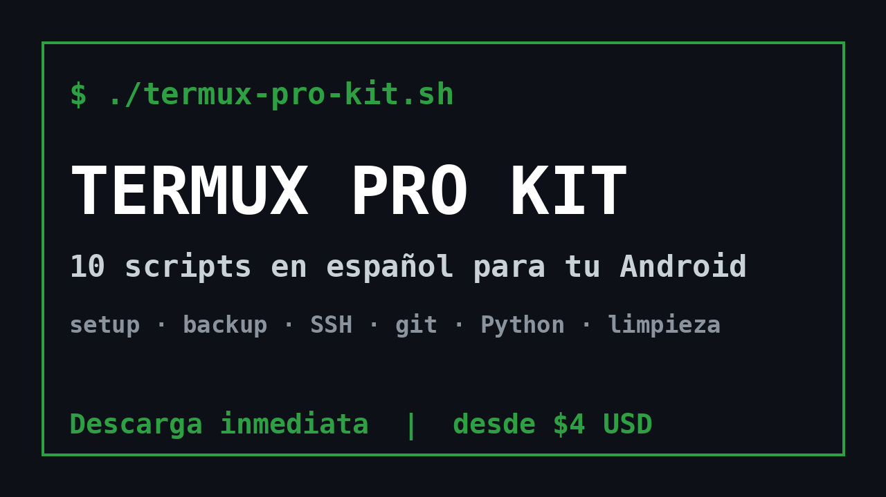

# Termux Pro Kit — 10 scripts en español para tu Android

Configura Termux en minutos: instalación inicial, respaldos, servidor SSH, entorno Python,
git, limpieza de espacio, servidor web local y más. Todos los scripts están comentados y no
envían datos a ningún servidor.



## Gratis: script de respaldo
Incluido en este repositorio: [`02-backup.sh`](02-backup.sh). Respalda tu HOME de Termux en
un `.tar.gz` dentro del almacenamiento compartido.

```bash
chmod +x 02-backup.sh && ./02-backup.sh
```

## Kit completo (10 scripts + guía)
| # | Script | Qué hace |
|---|--------|----------|
| 01 | setup-inicial | Instala git, python, node, ssh, jq |
| 02 | backup | Respaldo comprimido del HOME |
| 03 | ssh-servidor | Entra a tu teléfono por SSH |
| 04 | entorno-python | Proyecto Python con venv |
| 05 | git-config | Configura git y llave SSH |
| 06 | info-sistema | Memoria, disco, batería, red |
| 07 | limpieza | Libera caché de pkg, pip y npm |
| 08 | servidor-web | Comparte una carpeta por Wi‑Fi |
| 09 | alias-utiles | Atajos de terminal |
| 10 | recordatorio-bateria | Aviso de batería baja |

**Descárgalo aquí → https://swoosh784.gumroad.com/l/exgsmd**
